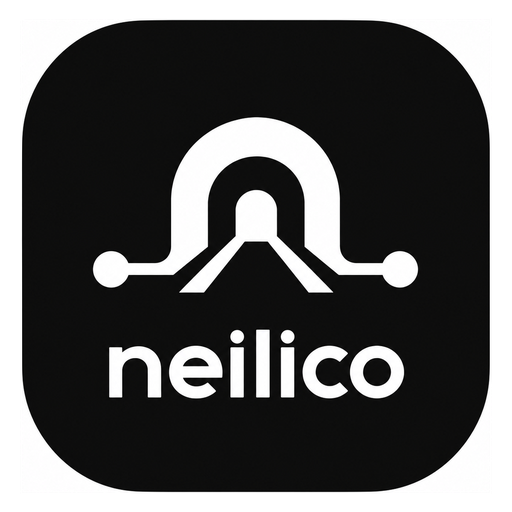
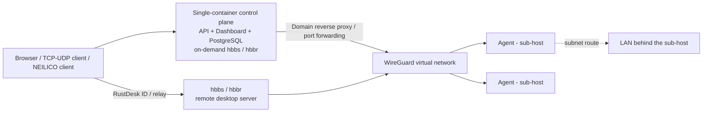

**English** | [简体中文](README.zh-CN.md)

<p align="center"></p>

# NEILICO

NEILICO is a self-hosted control plane for NAT traversal and mesh networking: **domain reverse proxying**, **TCP/UDP port forwarding**, **WireGuard virtual networks**, **subnet routing**, and **remote desktop** (RustDesk) managed from one web console. The control plane, Dashboard, PostgreSQL, and the RustDesk `hbbs`/`hbbr` servers ship as a **single container**; each sub-host runs an agent that receives and applies its WireGuard configuration.

Remote sessions are initiated by the separate [NEILICO client](https://github.com/aceneil/neilico-client); the web UI is for management and observability only.

## Contents

- [What it does](#what-it-does)
- [Architecture](#architecture)
- [Device capabilities: Mesh / subnet routes / tunnel](#device-capabilities-mesh--subnet-routes--tunnel)
- [Repository layout](#repository-layout)
- [Quick start](#quick-start)
- [Enrolling sub-hosts](#enrolling-sub-hosts)
- [Remote desktop](#remote-desktop)
- [Configuration quick reference](#configuration-quick-reference)
- [Documentation](#documentation)
- [Honest limitations](#honest-limitations)
- [License](#license)

## What it does

| Capability | Problem it solves | Where |
| :-- | :-- | :-- |
| **Domain reverse proxy** | Point `nas.example.com` at a port on an internal machine — one NPM-style form creates one proxy host | Domains & proxy → Reverse proxy |
| **Port forwarding** | Publish **any TCP/UDP** service (SSH, databases, game servers, DNS). Only the explicitly configured port is exposed, never the whole virtual network | Domains & proxy → Streams |
| **Mesh networking** | Give machines on different networks stable virtual IPs (`100.64.0.0/10`) so they behave like one LAN | Virtual networks / Devices |
| **Subnet routes** | Let other nodes reach the **entire LAN behind** a node, not just that node's virtual IP | Virtual networks → Subnet routes |
| **Remote desktop** | Self-hosted RustDesk `hbbs`/`hbbr`, started on demand and reclaimed when idle; devices and policies managed in the UI | Remote desktop |
| **Access & governance** | One-time enroll tokens with one-line installers (Docker / Linux / macOS / Windows), API tokens with scopes, RBAC and tenant isolation, audit log, alerting, certificates and PKI | Devices / API tokens / Alerts / PKI |

## Architecture



- **Control plane** (one container): REST API + Dashboard + PostgreSQL. It decides *what* each agent should run and pushes versioned configuration.
- **Agent** (sub-host): enrolls, sends heartbeats, reports capabilities, pulls configuration, and — where the platform and privileges allow — creates `wg0`, installs peer routes, and adds subnet routes.
- **Proxy and forwarding** both run inside the control plane: domain proxying handles HTTP/HTTPS, stream rules handle arbitrary TCP/UDP. Targets can be a node virtual IP, an internal physical address, or a node UUID.
- **RustDesk** ID/signaling and relay are compiled into the same image and started on demand.

## Device capabilities: Mesh / subnet routes / tunnel

Every device shows three badges — **Mesh**, **Subnet routes**, **Tunnel**. They are the agent's **honest self-report** of what the host can do, refreshed on enrollment and on every heartbeat. They are not proof that traffic flows: **online (heartbeat) does not mean the tunnel works**.

### What each badge means

| Badge | Field | `ready` means | How the agent decides | Effect when not `ready` |
| :-- | :-- | :-- | :-- | :-- |
| **Mesh** | `capabilities.mesh` | The host can join a virtual network: create `wg0`, receive a virtual IP, and exchange peer traffic | Linux: `wg` tool + `/dev/net/tun` + admin rights. Components present but no privilege → `degraded`; missing `wg` or TUN → `unavailable` | Mesh configuration is not applied, even if the UI lists the node as a network member |
| **Subnet routes** | `capabilities.subnet_routes` | The host can route **other networks** into the tunnel: traffic to `192.168.1.0/24` goes via `ip route ... dev wg0`, not just `100.64.0.x` | Requires the `ip` tool and admin rights to change routes | The LAN behind that node is unreachable from other nodes; only virtual IPs work |
| **Tunnel** | `capabilities.tunnel` | The host can actually create a WireGuard interface — the lowest-level and **authoritative** signal | On Linux, a real, reversible probe: create and delete a throwaway interface `neilico-p<pid>`. Failures put the underlying error into `reason` | The agent refuses to apply mesh configuration (dry-run only); no `wg0` appears on the host |

### Why you need all three

A working tunnel = **can create the interface (tunnel)** + **can configure address and peers (mesh)** + **can route networks into it (subnet routes)**.
If any one is missing, the control plane does not consider the configuration applicable (`MeshApplicable()` requires all three `ready`). That is why the device view also exposes `effective_mesh`: **`tunnel` is authoritative and the most pessimistic value wins**, so `mesh=ready` with `tunnel=unavailable` can never be shown as green.

> Historical pitfall: an earlier build decided "tunnel" by looking for an external client binary (`neilico-tunnel`/`npc`). Hosts that could create kernel WireGuard interfaces were reported unavailable, the agent skipped applying configuration, **`wg0` never appeared — and the UI stayed green**. Tunnel capability is now decided only by "can it really be created".

### Platform matrix (current implementation)

| Platform / condition | Mesh | Tunnel | Subnet routes |
| :-- | :-- | :-- | :-- |
| Linux + root or `CAP_NET_ADMIN` + `/dev/net/tun` | `ready` | `ready` (real interface probe passes) | `ready` |
| Linux without privileges | `degraded` | `unavailable` (probe fails with the real error) | `unavailable` |
| macOS | `degraded` (WireGuard component found, but this agent has no interface-creation adapter for macOS) | `unavailable` | `unavailable` |
| Windows | `degraded` (same) | `unavailable` | `unavailable` |

### Making them green

```bash
# The two flags that matter: capabilities and device access
docker run -d --network host --cap-add NET_ADMIN --device /dev/net/tun \
  -v neilico-agent-state:/var/lib/neilico-agent \
  -e NEILICO_TOKEN=<TOKEN> ghcr.io/aceneil/neilico-agent:latest
```

- No `NET_ADMIN` → handshakes may pass but no interface and no route changes;
- No `/dev/net/tun` → no interface;
- Kernel without WireGuard → interface creation fails, and `reason` carries the error;
- The container also needs the `ip` tool (present in the official agent image).

When a badge looks wrong, check in this order: `ip -brief addr show wg0` → `ip route | grep 100.64` → `docker inspect <agent> --format '{{.Config.Image}} {{.Image}}'` (did the image actually change?) → look for `local mesh state drift detected; re-applying` in the agent log.

### Where to see it

- **Dashboard → Devices**: the "capabilities" column, and the detail drawer with badges and reasons;
- **API**: `GET /api/v1/nodes` returns `capabilities` (`mesh` / `subnet_routes` / `tunnel` / `reason`), `effective_mesh`, `capabilities_note`, `heartbeat_stale`, and `last_seen`.

## Repository layout

| Path | Purpose |
| :-- | :-- |
| `control-plane/` | Go API, authentication and authorization, tenants, nodes, networks, rules, metrics, and remote-desktop control |
| `agent/` | Sub-host agent, capability detection, WireGuard setup, routing, and forwarding |
| `dashboard/` | Vue 3 + Ant Design Vue Dashboard |
| `third_party/rustdesk-server/` | Vendored RustDesk Server `hbbs`/`hbbr` (AGPL-3.0) |
| `deploy/` | Single-container, agent, Compose, and Helm deployment files |
| [`docs/`](docs/README.md) | Specifications, enrollment, operations, remote desktop, and network-boundary documentation |
| `cli/` | `neilicoctl` command-line tool |
| `scripts/` | Smoke, TLS, verification, and operations scripts |

The Flutter device-management app, formerly under `desktop/`, and the `rust-core/` skeleton have moved to [`app/`](https://github.com/aceneil/neilico-client/tree/neilico/app) in [aceneil/neilico-client](https://github.com/aceneil/neilico-client). The old directories remain here temporarily to support migration.

## Quick start

Use the reference Compose file [`deploy/server/docker-compose.yml`](deploy/server/docker-compose.yml) and environment template [`deploy/server/.env.example`](deploy/server/.env.example). Point the Compose `env_file` and persistent volumes at a data directory of your choice before starting.

```bash
cd deploy/server
cp .env.example <your-data-root>/neilico.env
# Generate and replace POSTGRES_PASSWORD, NEILICO_AUTH_JWT_SECRET,
# NEILICO_BOOTSTRAP_ADMIN_EMAIL, and NEILICO_BOOTSTRAP_ADMIN_PASSWORD.
chmod 600 <your-data-root>/neilico.env
docker compose up -d --build
curl -fsS http://127.0.0.1:13000/healthz
```

Open `http://127.0.0.1:13000/` for the Dashboard and API. The built-in reverse proxy listens on `18081` by default.

For the first login, either configure `NEILICO_BOOTSTRAP_ADMIN_*`, or leave them unset and use **First use? Register**. That form calls `GET /api/v1/setup/status`; when `registration_open=true`, the first account becomes the platform administrator and is signed in automatically. Later attempts return `409 already_initialized`. A configured bootstrap password must be at least 16 characters and contain at least three of four character classes.

## Enrolling sub-hosts

Create a one-time enroll token in the Dashboard, then use the Linux/macOS or Windows installer:

```bash
curl -fsSL https://<SERVER>/install.sh | sudo bash -s -- --token <TOKEN>
```

```powershell
powershell -ExecutionPolicy Bypass -Command "& ([scriptblock]::Create((irm https://<SERVER>/install.ps1))) -Token <TOKEN>"
```

The installers download the matching agent, verify SHA-256, install a service, and store the one-time credentials. They also support `--name`, `--server`, and `--dry-run`. The Docker agent example is in [`deploy/agent/README.md`](deploy/agent/README.md) — the same command shown in the capabilities section above.

Real WireGuard operation requires `NET_ADMIN` or equivalent administrator rights, `/dev/net/tun`, and kernel or system WireGuard support. If a requirement is missing, the agent reports `mesh`, `subnet_routes`, or `tunnel` as unavailable (with the reason) instead of claiming connectivity.

## Remote desktop

RustDesk `hbbs` for ID/signaling and `hbbr` for relay are compiled into the single-container image and started by the control plane on demand. The default `on_demand` mode starts them only when needed and stops them after `NEILICO_RD_IDLE_TIMEOUT` of inactivity. `always_on` and `off` are also supported. The ports are `21115-21119`, with `21116` used over both TCP and UDP; it is normal for nothing to listen while the service is disabled.

`hbbr` starts with `-k _` for RustDesk protocol-key validation. This is not a NEILICO account or device allowlist. By default, the ID/relay endpoint accepts registration from any client that can reach it. Public deployments must restrict exposure and source access. Encryption is provided by the RustDesk protocol. The web UI manages devices and policies but exposes no connection entry point. Download and platform status for the separate client are documented in [aceneil/neilico-client](https://github.com/aceneil/neilico-client).

## Configuration quick reference

| Variable | Purpose |
| :-- | :-- |
| `POSTGRES_PASSWORD`, `NEILICO_AUTH_JWT_SECRET` | Required database and JWT secrets; keep them only in a protected environment file |
| `NEILICO_BOOTSTRAP_ADMIN_EMAIL` / `_PASSWORD` | Initial administrator; omit both to use first-run registration |
| `NEILICO_SERVER_PORT` | Control-plane API/Dashboard port; Compose publishes it as `13000` |
| `NEILICO_PROXY_LISTEN` | Built-in reverse-proxy listener; Compose publishes it as `18081` |
| `NEILICO_RD_ENABLED`, `NEILICO_RD_ID_SERVER`, `NEILICO_RD_RELAY_SERVER` | Remote-desktop switch and advertised server addresses |
| `NEILICO_RD_SERVER_MODE`, `NEILICO_RD_IDLE_TIMEOUT` | `on_demand`/`always_on`/`off` lifecycle and idle shutdown |
| `NEILICO_RD_KEY_DIR`, `NEILICO_RD_PUBLIC_KEY_FILE` | Server key directory and read-only public-key path; the private key does not leave the key directory |
| `NEILICO_RD_PORTS`, `NEILICO_RD_RELAY_PORT`, `NEILICO_RD_UDP_PORT` | hbbs/hbbr listening and health-check ports |
| `NEILICO_RD_RELAY_HOST` | Explicit relay host passed to `hbbs -r` |
| `RUSTDESK_RELAY_HOST` | Relay hostname used by public deployments and clients; the control plane reads `NEILICO_RD_RELAY_HOST`, so automation must map the two names |
| `NEILICO_DOWNLOADS_DIR` | Artifact directory served by `/downloads/...`, `install.sh`, and `install.ps1` |
| `NEILICO_STREAM_PORT_MIN` / `_MAX` | Allowed TCP/UDP range for published stream rules |

## Documentation

Start with the bilingual [documentation index](docs/README.md). The main references are the [Control API](docs/API.md), [agent enrollment](docs/AGENT_ENROLL.md), [four-platform agent acceptance checklist](docs/AGENT_ACCEPTANCE.md), [operations guide](docs/OPS.md), [remote-desktop integration](docs/REMOTE_DESKTOP.md), [public deployment checklist](docs/DEPLOY_PUBLIC.md), and [NEILICONET feasibility analysis](docs/NEILICONET.md).

## Honest limitations

- Control-plane TLS and mTLS are disabled by default, so the default LAN HTTP endpoint is plaintext. Read [`docs/OPS.md`](docs/OPS.md) before enabling TLS or mTLS. A public entry point must terminate TLS elsewhere or explicitly enable it.
- There is no built-in P2P hole punching. WireGuard cannot establish a path when both NAT endpoints are unreachable. See [`docs/NEILICONET.md`](docs/NEILICONET.md) and [`docs/DEPLOY_PUBLIC.md`](docs/DEPLOY_PUBLIC.md) for boundaries and reachability requirements.
- `/metrics` has no real collection for `neilico_p2p_success_rate` or `neilico_relay_bytes`; both metrics are always `0`.
- Agent capabilities are downgraded honestly based on platform support and privileges. macOS and Windows currently lack interface-creation and routing adapters, so they report `degraded`/`unavailable` rather than a false green.
- `third_party/rustdesk-server` is **AGPL-3.0**; see [`third_party/rustdesk-server/LICENSE`](third_party/rustdesk-server/LICENSE).

## License

The root [`LICENSE`](LICENSE) remains a placeholder and the **root-repository license is pending**. This README does not select a license on the owner's behalf. Third-party RustDesk Server source and vendored Cargo dependencies retain their own licenses; see [`NOTICE`](NOTICE) and `third_party/rustdesk-server/`.
