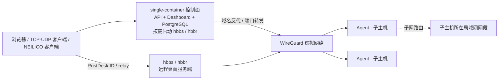

[English](README.md) | **简体中文**

# NEILICO

NEILICO 是一套自托管的内网穿透与 Mesh 组网控制面：**域名反向代理**、**TCP/UDP 端口转发**、**WireGuard 虚拟网络**、**子网路由**与**远程桌面**（RustDesk）集中在一个 Web 后台里管理。控制面、Dashboard、PostgreSQL 与 RustDesk 服务端（`hbbs`/`hbbr`）打包成**一个 single-container 容器**；各台子主机跑一个 Agent，负责领取并应用 WireGuard 配置。

远程连接本身由独立的 [NEILICO client](https://github.com/aceneil/neilico-client) 发起，Web 只做管理与可视化。

## 目录

- [能做什么](#能做什么)
- [架构](#架构)
- [设备能力：Mesh / 子网路由 / 隧道](#设备能力mesh--子网路由--隧道)
- [目录结构](#目录结构)
- [快速开始](#快速开始)
- [子主机接入](#子主机接入)
- [远程桌面](#远程桌面)
- [配置速查](#配置速查)
- [文档入口](#文档入口)
- [诚实限制](#诚实限制)
- [许可](#许可)

## 能做什么

| 能力 | 解决的问题 | 入口 |
| :-- | :-- | :-- |
| **域名反代** | 把 `nas.example.com` 这类域名接到内网某台机器的某个端口（NPM 式「一张表单 = 一个代理主机」） | 域名与代理 → 域名反代 |
| **端口转发** | 发布**任意 TCP/UDP** 端口（SSH、数据库、游戏服、DNS），只开放显式配置的那一个端口，不把整个虚拟网暴露出去 | 域名与代理 → 端口转发 |
| **Mesh 组网** | 让分布在不同网络里的机器获得稳定的虚拟 IP（`100.64.0.0/10`），彼此像在同一局域网内 | 虚拟网络 / 设备管理 |
| **子网路由** | 让「节点 A 后面的整个网段」也能被其它节点访问，而不只是 A 自己的虚拟 IP | 虚拟网络 → 子网路由 |
| **远程桌面** | 自建 RustDesk `hbbs`/`hbbr`，按需启动、空闲回收；Web 管理设备与授权策略 | 远程桌面 |
| **接入与治理** | 一次性 enroll 令牌 + 一键安装脚本（Docker / Linux / macOS / Windows）、API Token 与 scope、RBAC/租户隔离、审计日志、告警、证书与 PKI | 设备管理 / API Token / 告警中心 / PKI·CA |

## 架构



- **控制面**（单容器）：REST API + Dashboard + PostgreSQL；决定「谁该收到什么配置」，并把版本化配置下发给 Agent。
- **Agent**（子主机）：注册、心跳、能力上报、拉配置；在有权限的平台上创建 `wg0`、写入 peer 路由与子网路由。
- **反代与转发**：都跑在控制面里。域名反代管 HTTP/HTTPS；端口转发管任意 TCP/UDP。两者的目标都可以是节点虚拟 IP、内网物理地址或节点 UUID。
- **RustDesk**：ID/信令与中继在同一个镜像里，默认按需拉起。

## 设备能力：Mesh / 子网路由 / 隧道

设备管理页每台设备会显示三个能力徽标：**Mesh**、**子网路由**、**隧道**。它们是 Agent 在接入与每次心跳时**如实上报**的宿主机能力，不是"已连通"的证明——**在线（心跳）≠ 隧道可用**。

### 三个徽标分别是什么意思

| 徽标 | 字段 | `ready` 意味着什么 | Agent 怎么判定 | 不为 `ready` 的后果 |
| :-- | :-- | :-- | :-- | :-- |
| **Mesh** | `capabilities.mesh` | 这台机器能成为虚拟网络成员：建得起 `wg0`、分得到虚拟 IP、能按配置收发 peer 流量 | Linux：有 `wg` 工具 + `/dev/net/tun` + 管理员权限；组件齐全但无权限 → `degraded`；缺 `wg` 或无 TUN → `unavailable` | 不会应用 Mesh 配置（即使界面里"已加入网络"） |
| **子网路由** | `capabilities.subnet_routes` | 这台机器能把**对端网段**路由进隧道：访问 `192.168.1.0/24` 时按 `ip route ... dev wg0` 走隧道，而不只是访问 `100.64.0.x` 虚拟 IP | 需要 `ip` 工具 + 修改路由的管理员权限 | 跨节点的「对方局域网」不可达；只有虚拟 IP 通 |
| **隧道** | `capabilities.tunnel` | 这台机器**真的能创建 WireGuard 接口**（这是最底层、也是**权威**的信号） | Linux 上做一次**真实、可回滚**的探测：创建再删除一次性接口 `neilico-p<pid>`；失败会把底层真实错误写进 `reason` | Agent 拒绝应用 Mesh 配置（dry-run 打印配置但不落地），宿主上不会有 `wg0` |

### 三者为什么要一起看

一条隧道的可用性 = **能建接口（隧道）** + **能配地址与 peer（Mesh）** + **能把网段路由进去（子网路由）**。
缺少任何一项，控制面都不会把配置判为可应用（`MeshApplicable()` 要求三项全 `ready`）。因此设备页还会给出一个综合状态 `effective_mesh`：**以 `tunnel` 为权威、取三者中最悲观的值**，避免出现「`mesh=ready` 但 `tunnel=unavailable`」这种自相矛盾却显示绿灯的情况。

> 历史坑：早期实现把「隧道」判定为"外部客户端二进制 `neilico-tunnel`/`npc` 是否存在"。于是宿主机明明能建内核 WireGuard 接口，却被判成不可用，Agent 自己放弃应用配置——**宿主上永远没有 `wg0`，而界面还是绿的**。现在隧道能力只认"真的建得起来"。

### 平台矩阵（当前实现）

| 平台 / 条件 | Mesh | 隧道 | 子网路由 |
| :-- | :-- | :-- | :-- |
| Linux + root 或 `CAP_NET_ADMIN` + `/dev/net/tun` | `ready` | `ready`（真实建接口探测通过） | `ready` |
| Linux 但权限不足 | `degraded` | `unavailable`（探测会失败并给出真实原因） | `unavailable` |
| macOS | `degraded`（检测到 WireGuard 组件，但当前 Agent 的接口创建适配不支持） | `unavailable` | `unavailable` |
| Windows | `degraded`（同上） | `unavailable` | `unavailable` |

### 怎么让它变绿

```bash
# Docker 方式（最关键的两行：能力与设备）
docker run -d --network host --cap-add NET_ADMIN --device /dev/net/tun \
  -v neilico-agent-state:/var/lib/neilico-agent \
  -e NEILICO_TOKEN=<TOKEN> ghcr.io/aceneil/neilico-agent:latest
```

- 缺 `NET_ADMIN` → 能握手不能建接口、不能改路由；
- 缺 `/dev/net/tun` → 建不了接口；
- 宿主机内核未提供 WireGuard → 建接口直接失败（`reason` 会写出具体错误）；
- 容器内还要有 `ip` 工具（官方 Agent 镜像自带）。

怀疑状态不对时，按这个顺序查：`ip -brief addr show wg0` → `ip route | grep 100.64` → `docker inspect <agent> --format '{{.Config.Image}} {{.Image}}'`（镜像真的换了吗）→ Agent 日志里有没有 `local mesh state drift detected; re-applying`。

### 在哪里看

- **Dashboard → 设备管理**：列表的「接入能力」列、详情抽屉里的能力徽标与原因；
- **API**：`GET /api/v1/nodes` 返回 `capabilities`（`mesh` / `subnet_routes` / `tunnel` / `reason`）、`effective_mesh`、`capabilities_note`、`heartbeat_stale`、`last_seen`。

## 目录结构

| 路径 | 用途 |
| :-- | :-- |
| `control-plane/` | Go API、认证授权、租户、节点、网络、规则、指标和远程桌面控制 |
| `agent/` | 子主机 Agent、能力探测、WireGuard 应用、路由与转发 |
| `dashboard/` | Vue 3 + Ant Design Vue Dashboard |
| `third_party/rustdesk-server/` | vendored RustDesk Server `hbbs`/`hbbr`（AGPL-3.0） |
| `deploy/` | single-container、Agent、Compose 和 Helm 部署文件 |
| [`docs/`](docs/README.md) | 规格、接入、运维、远程桌面和网络边界文档 |
| `cli/` | `neilicoctl` 命令行 |
| `scripts/` | 冒烟、TLS、验证和运维脚本 |

Flutter 设备管理端（原 `desktop/`）和 `rust-core/` 骨架已迁移到 [aceneil/neilico-client](https://github.com/aceneil/neilico-client) 的 [`app/`](https://github.com/aceneil/neilico-client/tree/neilico/app)。旧目录暂时保留，以便迁移过渡。

## 快速开始

使用参考 Compose 文件 [`deploy/server/docker-compose.yml`](deploy/server/docker-compose.yml) 和环境变量模板 [`deploy/server/.env.example`](deploy/server/.env.example)。启动前把 Compose 的 `env_file` 和持久卷指向你选定的数据目录。

```bash
cd deploy/server
cp .env.example <your-data-root>/neilico.env
# 生成并替换 POSTGRES_PASSWORD、NEILICO_AUTH_JWT_SECRET、
# NEILICO_BOOTSTRAP_ADMIN_EMAIL 和 NEILICO_BOOTSTRAP_ADMIN_PASSWORD。
chmod 600 <your-data-root>/neilico.env
docker compose up -d --build
curl -fsS http://127.0.0.1:13000/healthz
```

访问 `http://127.0.0.1:13000/` 使用 Dashboard 和 API。内置反代默认监听 `18081`。

首次登录有两种方式：配置 `NEILICO_BOOTSTRAP_ADMIN_*`；或者不配置它们，在登录页使用「首次使用？注册」。注册表单会请求 `GET /api/v1/setup/status`，`registration_open=true` 时首个账号成为平台管理员并自动登录；系统已有账号后再次注册会返回 `409 already_initialized`。bootstrap 密码必须至少 16 个字符，并包含四类字符中的至少三类。

## 子主机接入

在 Dashboard 创建一次性 enroll token，然后使用 Linux/macOS 或 Windows 安装器：

```bash
curl -fsSL https://<SERVER>/install.sh | sudo bash -s -- --token <TOKEN>
```

```powershell
powershell -ExecutionPolicy Bypass -Command "& ([scriptblock]::Create((irm https://<SERVER>/install.ps1))) -Token <TOKEN>"
```

安装脚本会下载对应架构的 Agent、校验 SHA-256、安装服务并保存一次性凭据；还支持 `--name`、`--server` 和 `--dry-run`。Docker Agent 的完整示例见 [`deploy/agent/README.md`](deploy/agent/README.md)（也就是上一节 `docker run` 那条命令）。

真实 WireGuard 需要 `NET_ADMIN` 或等价管理员权限、`/dev/net/tun` 以及内核或系统 WireGuard 支持。缺少任一项时，Agent 会把 `mesh`、`subnet_routes` 或 `tunnel` 如实上报为不可用（并写明原因），不会伪造已连通。

## 远程桌面

RustDesk `hbbs`（ID/信令）和 `hbbr`（中继）已编译进 single-container 镜像，由控制面按需启动。默认 `on_demand` 模式只在有活动时启动，并在空闲超过 `NEILICO_RD_IDLE_TIMEOUT` 后回收；也支持 `always_on` 和 `off`。端口为 `21115-21119`，其中 `21116` 同时使用 TCP/UDP；服务未启用时不监听是正常的。

`hbbr` 启动时使用 `-k _` 做 RustDesk 协议 Key 校验，但这不是 NEILICO 账号/设备白名单。ID/中继入口默认接受任何能够到达服务端的客户端注册，公网部署必须自行限制暴露面和访问来源。加密由 RustDesk 协议负责。Web 只管理设备与策略，不提供连接入口。独立客户端的下载方式和平台状态见 [aceneil/neilico-client](https://github.com/aceneil/neilico-client)。

## 配置速查

| 变量 | 作用 |
| :-- | :-- |
| `POSTGRES_PASSWORD`、`NEILICO_AUTH_JWT_SECRET` | 数据库和 JWT 必填秘密；只放在受保护的 env 文件中 |
| `NEILICO_BOOTSTRAP_ADMIN_EMAIL` / `_PASSWORD` | 首个管理员；两者都未配置时走首次注册 |
| `NEILICO_SERVER_PORT` | 控制面 API/Dashboard 端口；Compose 映射为 `13000` |
| `NEILICO_PROXY_LISTEN` | 内置反代监听；Compose 映射为 `18081` |
| `NEILICO_RD_ENABLED`、`NEILICO_RD_ID_SERVER`、`NEILICO_RD_RELAY_SERVER` | 远程桌面总开关和下发地址 |
| `NEILICO_RD_SERVER_MODE`、`NEILICO_RD_IDLE_TIMEOUT` | `on_demand`/`always_on`/`off` 生命周期和空闲回收 |
| `NEILICO_RD_KEY_DIR`、`NEILICO_RD_PUBLIC_KEY_FILE` | 服务端密钥目录和只读公钥路径；私钥不离开密钥目录 |
| `NEILICO_RD_PORTS`、`NEILICO_RD_RELAY_PORT`、`NEILICO_RD_UDP_PORT` | hbbs/hbbr 监听与探活端口 |
| `NEILICO_RD_RELAY_HOST` | 传给 `hbbs -r` 的显式中继主机 |
| `RUSTDESK_RELAY_HOST` | 公网部署/客户端侧使用的中继主机名；控制面实际读取 `NEILICO_RD_RELAY_HOST`，自动化时需映射两个名称 |
| `NEILICO_DOWNLOADS_DIR` | `/downloads/...`、`install.sh` 和 `install.ps1` 使用的产物目录 |
| `NEILICO_STREAM_PORT_MIN` / `_MAX` | 端口转发规则允许发布的 TCP/UDP 端口区间 |

## 文档入口

从双语 [文档索引](docs/README.md) 开始。主要参考包括 [Control API](docs/API.md)、[Agent 接入](docs/AGENT_ENROLL.md)、[Agent 四平台验收清单](docs/AGENT_ACCEPTANCE.md)、[运维手册](docs/OPS.md)、[远程桌面集成](docs/REMOTE_DESKTOP.md)、[公网部署清单](docs/DEPLOY_PUBLIC.md) 和 [NEILICONET 可行性分析](docs/NEILICONET.md)。

## 诚实限制

- 控制面 TLS/mTLS 默认关闭，默认 LAN 访问是明文 HTTP。启用 TLS/mTLS 前阅读 [`docs/OPS.md`](docs/OPS.md)；公网入口必须自行终止 TLS 或显式开启。
- 当前没有自带 P2P 打洞。NAT 两端都不可达时，WireGuard 建不起来。边界、端口转发和可达性条件见 [`docs/NEILICONET.md`](docs/NEILICONET.md) 与 [`docs/DEPLOY_PUBLIC.md`](docs/DEPLOY_PUBLIC.md)。
- `/metrics` 没有接入 `neilico_p2p_success_rate` 或 `neilico_relay_bytes` 的真实采集，两者恒为 `0`。
- Agent 能力按平台与权限如实降级；macOS/Windows 目前的接口创建与路由适配尚未实现，它们会显示 `degraded`/`unavailable` 而不是假绿。
- `third_party/rustdesk-server` 是 **AGPL-3.0**，原文见 [`third_party/rustdesk-server/LICENSE`](third_party/rustdesk-server/LICENSE)。

## 许可

根目录 [`LICENSE`](LICENSE) 仍为占位文件，**主仓库许可待定**。本 README 不替所有者选择许可。第三方 RustDesk Server 源码及 vendored Cargo 依赖保留各自许可，见 [`NOTICE`](NOTICE) 和 `third_party/rustdesk-server/`。
